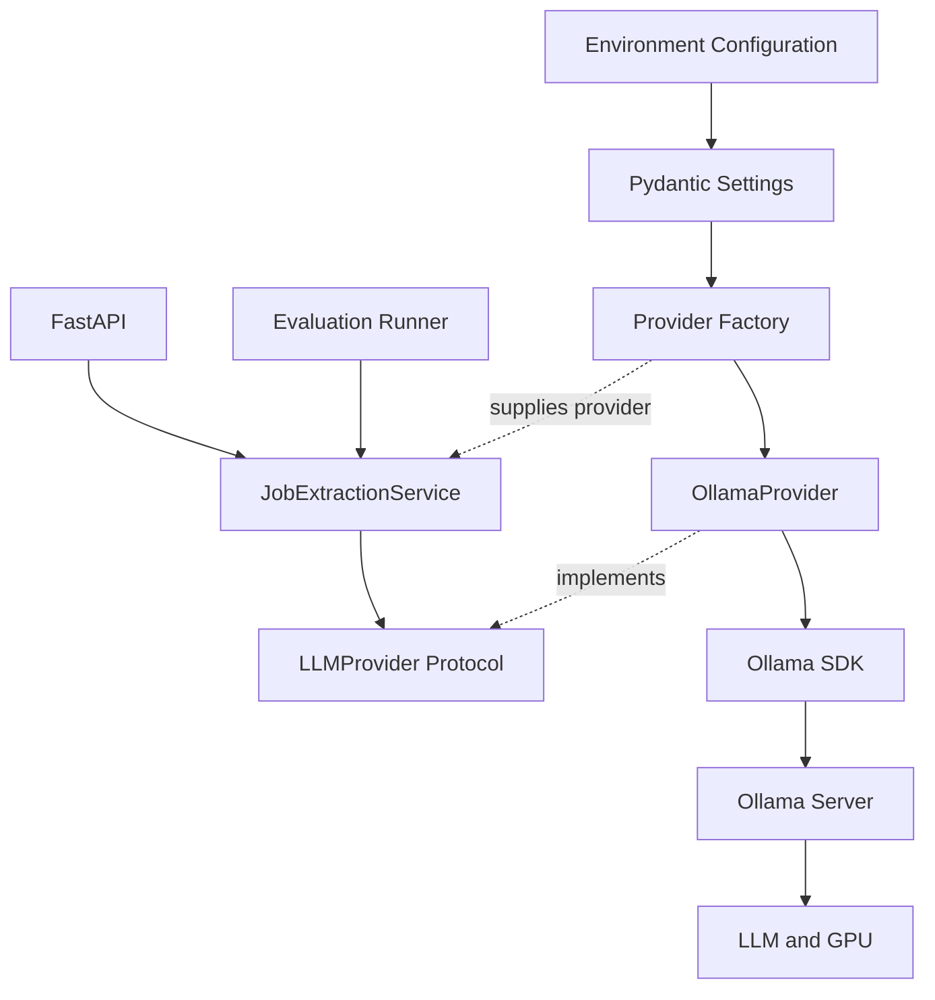

# Modular LLM Inference Architecture

## Objective

JobMatch separates application-specific extraction logic from LLM inference infrastructure to improve maintainability, testability and extensibility.

## Architecture



## Components

| Component | Responsibility |
|---|---|
| `app/inference/base.py` | Provider contract and common infrastructure exception |
| `app/inference/ollama_provider.py` | Ollama-specific request translation and error handling |
| `app/inference/factory.py` | Configuration-based provider construction |
| `app/services/llm_job_extractor.py` | Prompt construction, structured output validation and extraction business logic |
| `app/config.py` | Validated environment-based configuration |
| `evaluation/evaluate_extraction.py` | Requirements extraction evaluation |

## Design Decisions

### Provider abstraction

A Python Protocol defines an asynchronous structured generation interface. Concrete providers satisfy this interface through structural typing.

### Adapter pattern

The Ollama adapter translates provider-independent requests into Ollama-specific SDK calls.

### Dependency injection and inversion

The extraction service receives its inference provider through its constructor. Application logic depends on the provider contract rather than a concrete inference implementation.

### Provider factory

A centralized factory selects and constructs the configured provider.

### Exception handling

Infrastructure errors are translated into `LLMProviderError`. Application-level parsing and validation failures are handled through `LlmJobExtractionError`.

### Structured output

The provider receives a JSON schema and returns generated text. Application-specific JSON parsing, Pydantic validation and business rules remain within the extraction service.

## Configuration

The currently supported provider is Ollama.

```dotenv
LLM_PROVIDER=ollama
OLLAMA_HOST=http://127.0.0.1:11434
OLLAMA_MODEL=qwen3:4b-instruct-2507-q4_K_M
OLLAMA_TIMEOUT_SECONDS=300
OLLAMA_TEMPERATURE=0.0
OLLAMA_NUM_CTX=8192
OLLAMA_NUM_PREDICT=2048
LLM_MAX_INPUT_CHARACTERS=8000
```

Unsupported provider names are rejected during settings validation.

## Verification

The architecture is verified through:

- Provider request translation tests.
- Timeout and connection failure tests.
- Empty response handling tests.
- Configuration and factory tests.
- Provider-independent extraction tests.
- Existing application regression tests.
- Live requirements extraction using Ollama.

A total of 81 automated tests passed. All six development evaluation requests completed successfully in both live evaluation runs.

## Evaluation Observations

The initial live evaluation produced an F1-score of 62.30%, compared with 65.57% in a previously recorded V2 run. The observed difference corresponds to one soft skill being classified as a qualification.

The first inference request took 16.95 seconds with no model previously loaded. The remaining five requests averaged approximately 1.61 seconds.

A second evaluation with the model already loaded produced identical predictions across all six samples, with a mean latency of 1.54 seconds.

Ollama reported 100% GPU offloading, an 8192-token context window and a loaded size of 3.8 GB on an NVIDIA GeForce RTX 5060 with 8 GB of VRAM.

| Metric | Initially unloaded run | Warm run |
|---|---:|---:|
| Successful extractions | 6/6 | 6/6 |
| Precision | 57.58% | 57.58% |
| Recall | 67.86% | 67.86% |
| F1-score | 62.30% | 62.30% |
| First request latency | 16.95 s | 1.91 s |
| Mean latency | 4.17 s | 1.54 s |

Results are recorded in `evaluation/results/modular_ollama_v0.json`.

These observations are not sufficient to establish performance improvements or degradation caused by the architectural refactoring. The evaluation dataset is small and synthetic, and model-loading conditions differ between runs.

## Limitations and Future Work

- Ollama is currently the only implemented provider.
- Standalone llama.cpp and vLLM adapters remain planned.
- The provider contract does not yet expose token usage or inference timing metadata.
- Cold-start and warm inference require separate controlled benchmarking.
- Explicit inference client lifecycle management remains future work.
- Extraction quality remains model-dependent.

Future work will introduce containerized GPU deployment, additional inference providers, comparative benchmarking and automated infrastructure verification.